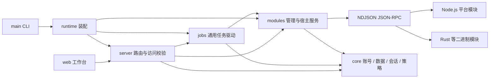
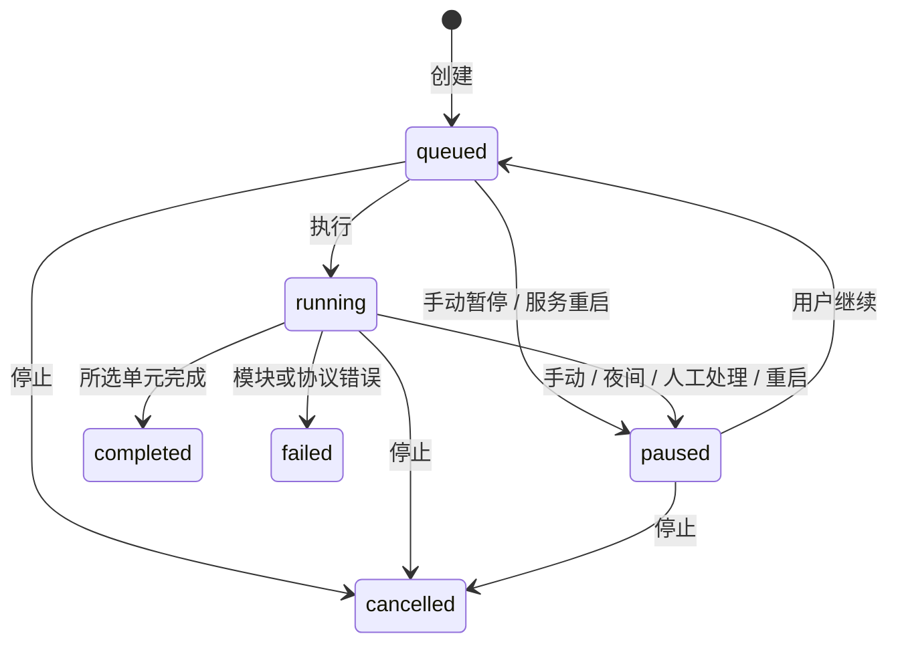

# 架构与工作流

## 职责边界

Courseflow framework 是稳定的通用宿主，`courseflow-zhs` 等模块负责平台协议，Courseweave／Studia 只提供历史参考。新增平台应增加模块，不应修改网页来判断平台 ID。

- `core/`：存储、加密、用户与平台会话、错误和时间策略。
- `modules/`：清单、协议 DTO、进程、网络宿主与安装生命周期。平台自己的 URL、签名、加密和页面解析留在外部模块。
- `jobs/`：通用 `study.step` 循环与持久化。只消费平台提供的课程和单元，不解释平台业务字段。
- `server/`：JSON／HTTP 适配，访问控制集中在 `access.ts`，按资源拆分路由。保持原有 API URL 与响应兼容。
- `runtime.ts`：创建依赖、构造 HTTP 应用和统一关闭。模块 CLI 关闭自己的资源，不恢复或暂停正在服务的另一个进程的任务。
- `web/`：无构建依赖的 ES 模块。`api.js` 处理请求与地址编码，`views.js` 输出已转义内容，`app.js` 管理导航和交互。模块提供的额外标签由服务端解析条件，前端只呈现；宿主尚未实现的标签禁用。

这是单个 Node.js 包，暂不拆成需要分别构建和发布的 monorepo。模块 ABI 继续是 `moduleApi: 1`，框架维持 `0.1.x` 以兼容现有 zhs 和 simulator 的版本范围。

## 浏览器状态

页面使用 hash 路由：`#/courses`、`#/platform/<id>`、`#/platform/<id>/course/<course>/<recruit>`、`#/tasks`、`#/connections`、`#/modules`、`#/account`。每段 ID 独立编码，不以原始斜杠拆课程键。

已连接平台的课程读取互相独立，一个模块失败不隐藏其他平台。路由和站点会话各有请求代次，页面切换或退出后，晚返回请求不能恢复旧页面。扫码有独立代次，关闭弹窗后忽略后续结果。

每 4 秒读取任务和站点策略，仅在数据变化时更新任务区域；每 5 轮更新平台与模块状态。隐藏页面时暂停轮询，切回页面立即刷新。轮询不重建课程目录、登录表单、模块设置或搜索框。

布局包括桌面平台侧栏、课程主区、底部任务栏，窄屏使用底部导航。原生 `progress` 元素配合外部 CSS，保持 `style-src 'self'`，不依赖内联宽度样式。主题偏好只保存在浏览器本地。

## 任务生命周期

暂停和停止会递增任务 `generation` 并取消等待。模块调用可能已经发出；步骤返回后必须再次检查取消状态与 generation，旧结果不能写入进度、检查点或完成状态。立即继续会等待旧执行退出，防止同一任务的两个执行器重叠。

退出服务先停止接收 HTTP，再取消并等待任务执行器，最后关闭模块和 SQLite。服务启动把遗留的 queued／running 任务转为 paused，保留加密检查点，需要用户核对后继续；不自动重发外部写入。这里尚不提供跨任务账号互斥或写入结果回读保障。

任务详情 `GET /api/tasks/:id` 返回任务与最近 100 条执行记录，访问按 owner 校验。新增控制是 `POST /api/tasks/:id/pause`；原有 stop／resume 接口保持兼容。

## 验证

`npm test` 覆盖通用协议、加密、模拟器完整链路、任务取消／恢复竞态、HTTP 资源与权限、页面地址编码和输出转义。相邻 zhs 的 release 二进制存在时运行 Rust fixture 契约集成；缺失时按测试声明跳过。`npm run typecheck` 和 `npm run check:web` 分别检查 TypeScript 与浏览器脚本。

真实账号、平台写入以及完整自动完成课程仍需单独验收；不把离线 fixture、浏览器页面或模块握手成功当作真实平台完成证明。
