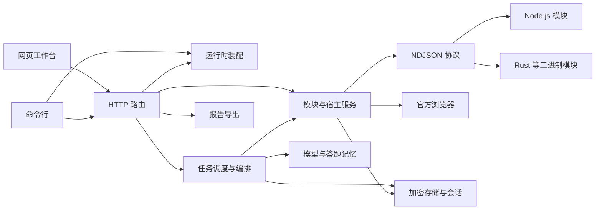
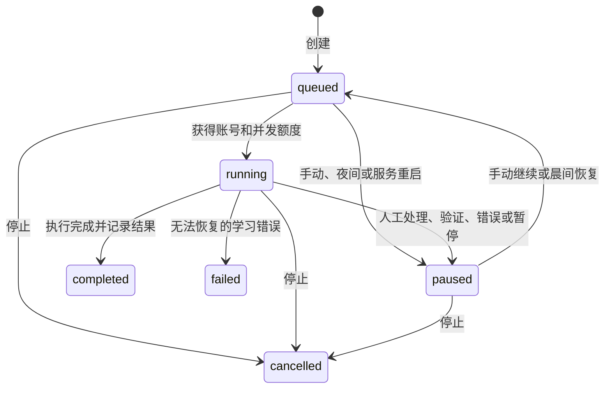

# 架构与工作流

## 职责

框架保持为一个 Node.js 包，模块通过 NDJSON JSON-RPC 子进程接入。平台 URL、网关密钥、签名、页面脚本及响应解析留在模块；宿主提供 HTTP、加密状态、官方浏览器与模型能力。网页不按平台 ID 分支，只消费通用课程、单元、试卷、题目和活动。

- `core/` 管理 SQLite、站点认证、平台会话、加密、偏好和北京时间策略。
- `modules/` 管理安装指纹、版本范围、握手、重启、会话能力及网络宿主。
- `jobs/engine.ts` 管理队列、用户并发、跨用户的同账号互斥、代次和检查点。
- `jobs/workflows.ts` 编排复习、分段读取试卷、草稿、确认、交卷回读和课程活动。
- `services/` 提供加密模型配置、答案校验与记忆、原生 CDP 浏览器、报告格式和私有日志存储。
- `runtime.ts` 只创建后端服务，不创建 HTTP 服务、不绑定端口、不注册进程信号。关闭时先取消语音转写，再依次停止任务、模块、官方浏览器和数据库。
- `server/` 是可选 HTTP 适配层，负责认证、资源和所有权校验；调用方通过 `createHttpServer()` 装配，先关闭 HTTP 再关闭运行时。CLI 负责监听端口和进程信号。
- [courseflow-webui](https://github.com/Course-Flow-Lab/courseflow-webui) 独立构建与发布，只通过 HTTP API 调用后端。静态资源由部署层托管，框架不导入前端文件。

Web API 使用独立的 `web_api_version: 1`；`module_api` 仍表示平台模块协议。后端包提供运行时入口和 `./http` 子入口，具体接口与生命周期见 [Web API 与嵌入方式](WEB-API.md)。

## 站点注册

首次初始化通过设置码创建管理员。初始化完成后，`/api/auth/register` 创建普通成员；注册策略存于 `site_settings`，默认必须提供邀请码，只有管理员可修改。网页的「注册与邀请」与手机端账号入口使用相同的管理员接口。

邀请码由密码学随机数生成，共五组、每组五位数字或大写英文字母，使用短横线连接。`invitations` 只保存 SHA-256 摘要、部分掩码、生成者与生成／使用／撤销时间，完整内容只在生成响应中返回。生成数量限制为每次一至一百个，列表返回最近一百条及全量统计。

注册先验证输入，再在密码哈希计算完成后进入 SQLite 写事务，重新检查最新策略与邀请码状态，将创建成员、标记邀请码已使用及创建站点会话一并提交。并发请求不能重复用码；失败整体回滚。用户名的重复校验与登录统一使用 `COLLATE NOCASE`，避免大小写不同的账号遮蔽已有登录。

管理员写入要求管理员身份、CSRF 和来源校验；公开注册也校验浏览器来源。操作记录只记录路由、状态与操作者，不读取邀请码或密码。注册设置与邀请码随数据库备份；升级数据库至版本 3 时保留已有账号与平台数据。

## 会话和浏览器

扫码挑战有独立 Cookie 容器。完成扫码后轮换连接编号，旧句柄失效，重新连接和断开会暂停当前平台的执行任务。

每轮任务获得绑定任务编号、执行代次及连接编号的临时句柄。每次宿主网络请求和每次重定向前复核任务仍在运行。暂停、停止或夜间策略会取消请求、删除句柄、关闭任务拥有的浏览器；晚返回结果不能覆盖新状态。

官方页面通过本机 Chromium 原生 CDP 驱动，每页独立无痕上下文，资料放在数据目录的 `browser-runtime/`。不会修改官方页面的 `Map` 构造器。见面课监听官方观看历史响应，加载历史后选择第一个缺失分钟，最终以平台签到回读确认。浏览器最多同时四页，无任务的只读页面空闲后自动关闭。

见面课初始化使用已确认的历史响应、视频目录和时间轴作为持久就绪证据，不要求官方播放后会复位的一次性标志继续为真。初始化等待超过六十秒时说明缺少的阶段；进入播放后仅用视频编号与播放秒数判断连续三分钟无进展。两种情况都暂停保留检查点。模块返回 `blocked` 才记录为不可自动处理的跳过项，`needs_human` 留在当前项供用户核对后继续。

HTTP Cookie 容器区分主机 Cookie 与域 Cookie，传入 Chromium 时为域 Cookie 补上前导点，避免父域登录态无法用于播放器子域。智慧树见面课给正常登录跳转保留最多三十秒；持续跳转或已确认的鉴权失败返回有类型的登录过期错误，使任务暂停等待重新连接，不再将该项作为人工跳过后结束。

初始和后续执行时的页面地址必须在模块声明的域名范围内。页面内部资源仍由 Chromium 加载；这不是浏览器网络沙箱。仅安装可信模块。

## 持久化与恢复

任务输入固定平台账号指纹、连接编号、模块版本、模型选择和操作选项。相同账号重新扫码可在核对后继续；账号或模块版本变化时暂停。偏好中的并发数和跨课程并行开关由调度器读取。服务重启将遗留执行任务暂停，保留检查点；CLI 实例不接管服务实例的任务。

夜间暂停默认启用，偏好 `quiet_hours` 按用户保存。调度、创建／继续／交卷、宿主请求、浏览器写入和提问草稿接口统一读取所属用户的设置。进入夜间只暂停仍启用该策略的用户；晨间或关闭开关后只恢复带有夜间暂停标记的任务，人工暂停保持原状。

平台状态与任务完成分别记录。共享课学习先等待实际时长再保存，完成后回读平台进度；每日复习累计复习秒数且保留原状态。见面课跳过项保存原因，任务执行结束不会将它们冒充为签到成功。掌握度最多三轮，未达满分保留未达标数量。

作答阶段为：目录 → 开卷 → 分段读取 → 答案 → 草稿 → 等待确认 → 提交意图 → 回读 → 下一份。开卷请求结果未知时不重复开卷；交卷锁在发送前持久化，未知状态只回读。锁按平台账号、课程、试卷及作答编号隔离。同账号的另一个用户也不能绕过未确认交卷锁。

答案记忆由 `src/question-bank/` 内置模块实现，内置服务注入加密存储，不再依赖外部 SDK 副本。正确／错误记录必须来自平台判定或明确复核；题目指纹包含用户、平台、课程、题型、题干、选项文字、图片和空数。选项更换编号或顺序后可映射，错误组合撤销相同的旧正确记录。模型答案先校验题型；已有平台答案默认保留，人工覆盖需显式勾选。

`migrate legacy` 独立运行，不创建在线模块或任务。只读检查旧数据库和配置后，在全新目录生成数据库和新主密钥；历史任务、报告及原始配置按用户加密归档。档案路由与现有会话权限统一，不能下载其他用户的内容，平台登录态需要重新建立。迁移范围见 [旧站点数据迁移](LEGACY-MIGRATION.md)。

## 网页与导出

hash 地址保留每段不透明 ID：`#/platform/<平台>/course/<课程>/<班级>/<功能>`。全局设置为 `#/settings`。路由、站点会话和扫码分别带请求代次，过期响应不能恢复旧界面。

任务每四秒更新，平台和模块每五轮更新；隐藏页面暂停轮询。刷新任务不重建正在编辑的答案、模型密钥或提问草稿。

问答区首屏并行读取成绩、本地发布记录和个人偏好，官方讨论列表按需加载。提问与回答分别显示进度格和数量调节，草稿可以编辑、删除、勾选后确认发布。同一次网页会话内按课程缓存草稿，刷新统计或切换课程后返回可继续编辑；重新加载整个网页不会持久保存未发布草稿。

图片经过当前用户的平台认证代理，来源地址加密保存，其他用户不可读取。Word 将 PNG／JPEG 嵌入文档；无法嵌入的格式提供需要登录站点的链接。Markdown 的题图也需要对应站点会话。JSON、Markdown 和 Word 保留当前作答与已确认提交的区别；CSV 对公式开头做转义。

「日志导出」使用北京时间范围，最长九十二天、单次二十 MB。运行日志与 HTTP 操作记录按日保存到数据目录的 `logs/`，目录权限 0700、文件 0600，仅管理员可导出；记录操作时不读取请求体。任务日志从 `task_events` 完整导出，不受网页最近一百条事件的显示限制，并按所有者隔离。播放器阶段、就绪条件与媒体状态变化写入任务诊断事件，避免每秒重复保存相同诊断。导出不会包含完整页面内容、Cookie 容器或密钥文件。

## 验证

框架使用 Node.js 测试运行器，智慧树使用 Cargo 离线模拟宿主。HTTP 权限、模块契约、取消竞态、原答案保留、人工补答、交卷锁、模型格式检测和加密存储均有自动检查。相邻的 `courseflow-zhs` release 二进制缺失时（克隆与构建步骤见 README），Rust 集成测试会明确跳过。

真实账号的进度保存、正式交卷、签到完成及发布记录必须在部署站点单独验收。功能可运行、测试通过和真实平台验收是不同状态。
