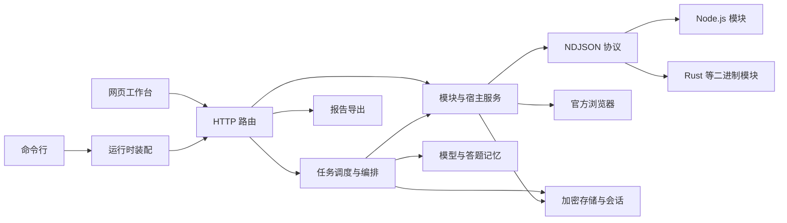
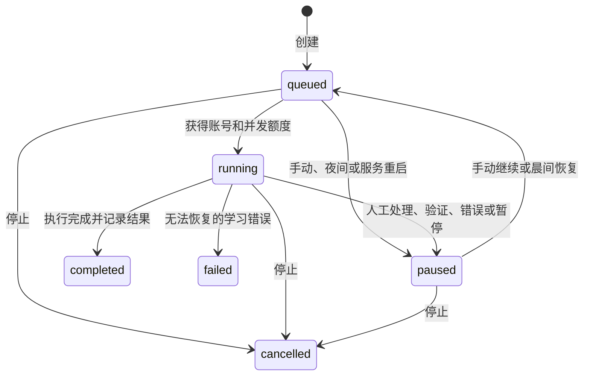

# 架构与工作流

## 职责

框架保持为一个 Node.js 包，模块通过 NDJSON JSON-RPC 子进程接入。平台 URL、网关密钥、签名、页面脚本及响应解析留在模块；宿主提供 HTTP、加密状态、官方浏览器与模型能力。网页不按平台 ID 分支，只消费通用课程、单元、试卷、题目和活动。

- `core/` 管理 SQLite、站点认证、平台会话、加密、偏好和北京时间策略。
- `modules/` 管理安装指纹、版本范围、握手、重启、会话能力及网络宿主。
- `jobs/engine.ts` 管理队列、用户并发、跨用户的同账号互斥、代次和检查点。
- `jobs/workflows.ts` 编排复习、分段读取试卷、草稿、确认、交卷回读和课程活动。
- `services/` 提供加密模型配置、答案校验与记忆、原生 CDP 浏览器及报告格式。
- `server/` 负责资源和所有权校验；`runtime.ts` 是 CLI、HTTP 和测试的共同装配入口。
- `web/features.js` 提供课程功能、模型设置和人工补答；`app.js` 管理导航及交互；`views.js` 保持通用布局。

## 会话和浏览器

扫码挑战有独立 Cookie 容器。完成扫码后轮换连接编号，旧句柄失效，重新连接和断开会暂停当前平台的执行任务。

每轮任务获得绑定任务编号、执行代次及连接编号的临时句柄。每次宿主网络请求和每次重定向前复核任务仍在运行。暂停、停止或夜间策略会取消请求、删除句柄、关闭任务拥有的浏览器；晚返回结果不能覆盖新状态。

官方页面通过本机 Chromium 原生 CDP 驱动，每页独立无痕上下文，资料放在数据目录的 `browser-runtime/`。不会修改官方页面的 `Map` 构造器。见面课监听官方观看历史响应，加载历史后选择第一个缺失分钟，最终以平台签到回读确认。浏览器最多同时四页，无任务的只读页面空闲后自动关闭。

初始和后续执行时的页面地址必须在模块声明的域名范围内。页面内部资源仍由 Chromium 加载；这不是浏览器网络沙箱。仅安装可信模块。

## 持久化与恢复

任务输入固定平台账号指纹、连接编号、模块版本、模型选择和操作选项。相同账号重新扫码可在核对后继续；账号或模块版本变化时暂停。偏好中的并发数和跨课程并行开关由调度器读取。服务重启将遗留执行任务暂停，保留检查点；CLI 实例不接管服务实例的任务。

平台状态与任务完成分别记录。共享课学习先等待实际时长再保存，完成后回读平台进度；每日复习累计复习秒数且保留原状态。见面课跳过项保存原因，任务执行结束不会将它们冒充为签到成功。掌握度最多三轮，未达满分保留未达标数量。

作答阶段为：目录 → 开卷 → 分段读取 → 答案 → 草稿 → 等待确认 → 提交意图 → 回读 → 下一份。开卷请求结果未知时不重复开卷；交卷锁在发送前持久化，未知状态只回读。锁按平台账号、课程、试卷及作答编号隔离。同账号的另一个用户也不能绕过未确认交卷锁。

只保存平台公布或判为正确的答案记忆。题目指纹包含课程、题型、题干、选项、图片和空数。模型答案先校验题型；已有平台答案默认保留，人工覆盖需显式勾选。

## 网页与导出

hash 地址保留每段不透明 ID：`#/platform/<平台>/course/<课程>/<班级>/<功能>`。全局设置为 `#/settings`。路由、站点会话和扫码分别带请求代次，过期响应不能恢复旧界面。

任务每四秒更新，平台和模块每五轮更新；隐藏页面暂停轮询。刷新任务不重建正在编辑的答案、模型密钥或提问草稿。

图片经过当前用户的平台认证代理，来源地址加密保存，其他用户不可读取。Word 将 PNG／JPEG 嵌入文档；无法嵌入的格式提供需要登录站点的链接。Markdown 的题图也需要对应站点会话。JSON、Markdown 和 Word 保留当前作答与已确认提交的区别；CSV 对公式开头做转义。

## 验证

框架使用 Node.js 测试运行器，智慧树使用 Cargo 离线模拟宿主。HTTP 权限、模块契约、取消竞态、原答案保留、人工补答、交卷锁、模型格式检测和加密存储均有自动检查。相邻的 `courseflow-zhs` release 二进制缺失时（克隆与构建步骤见 README），Rust 集成测试会明确跳过。

真实账号的进度保存、正式交卷、签到完成及发布记录必须在部署站点单独验收。功能可运行、测试通过和真实平台验收是不同状态。
